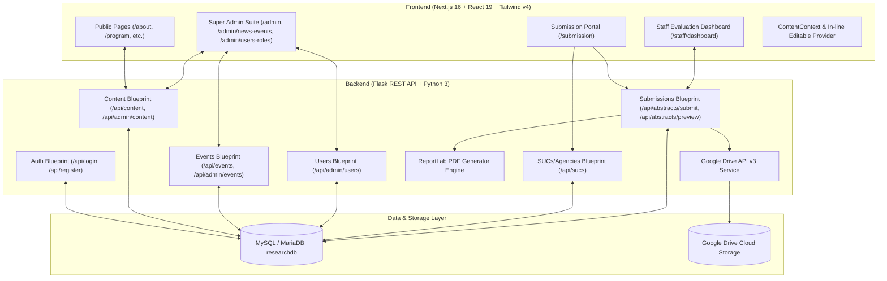
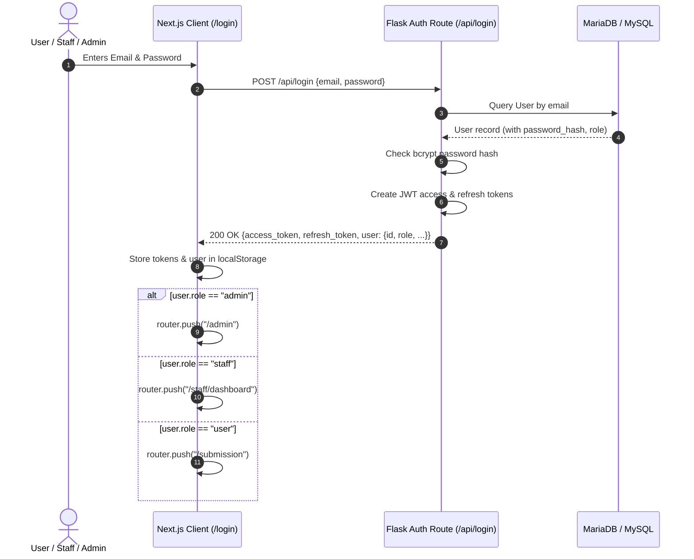
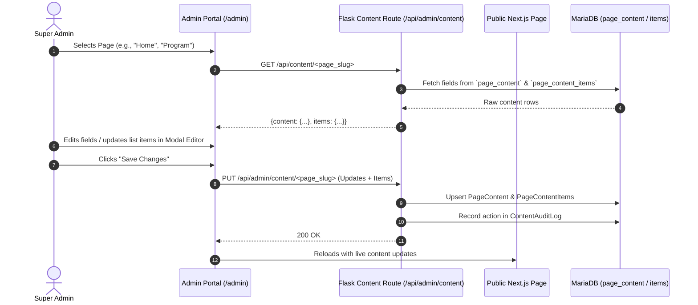
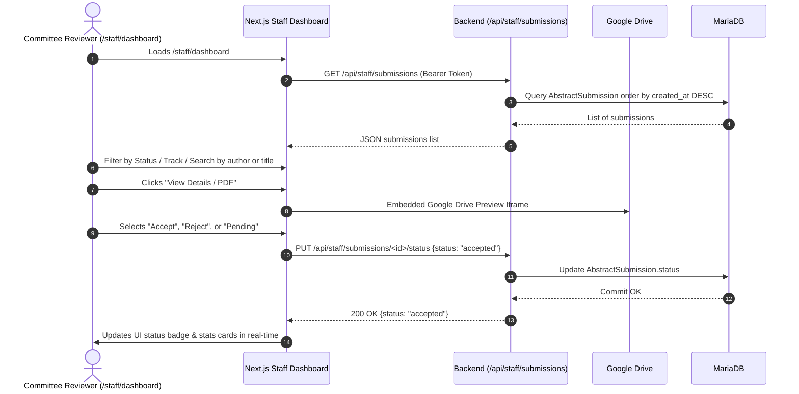
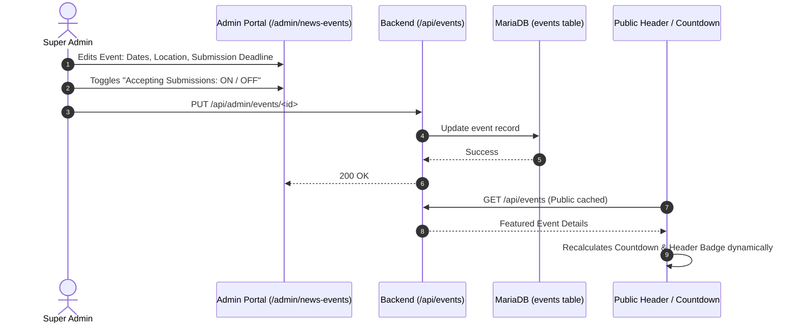

# International Colloquium & Symposium Portal — Architecture, Flow & Page Guide

A comprehensive architectural document detailing the system workflows, authentication, data lifecycles, and in-depth page specifications for the **International Colloquium & Symposium Web Application**.

---

## Table of Contents
1. [System Architecture Overview](#1-system-architecture-overview)
2. [User Roles & Permissions Matrix](#2-user-roles--permissions-matrix)
3. [End-to-End System Workflows](#3-end-to-end-system-workflows)
   - [Workflow A: User Authentication & Role-Based Routing](#workflow-a-user-authentication--role-based-routing)
   - [Workflow B: Dynamic Page Content Management (CMS)](#workflow-b-dynamic-page-content-management-cms)
   - [Workflow C: Abstract Submission, Automated PDF & Google Drive Pipeline](#workflow-c-abstract-submission-automated-pdf--google-drive-pipeline)
   - [Workflow D: Staff Abstract Review & Evaluation Pipeline](#workflow-d-staff-abstract-review--evaluation-pipeline)
   - [Workflow E: Symposium Event & Deadline Management](#workflow-e-symposium-event--deadline-management)
   - [Workflow F: User Role Administration](#workflow-f-user-role-administration)
4. [Detailed Page-by-Page Documentation](#4-detailed-page-by-page-documentation)
   - [Public Facing Pages](#public-facing-pages)
   - [Authentication & User Portal](#authentication--user-portal)
   - [Staff Portal](#staff-portal)
   - [Super Admin Portal](#super-admin-portal)
5. [Backend API Reference & Data Models](#5-backend-api-reference--data-models)
6. [Deployment & Environment Configuration](#6-deployment--environment-configuration)

---

## 1. System Architecture Overview



### Technology Stack
- **Frontend Framework**: Next.js 16.3.3 (App Router, Client Components, Static Export ready `output: 'export'`)
- **UI Library**: React 19.2.8, Tailwind CSS v4, Lucide React & React Icons
- **Interactive UI**: Framer Motion, Leaflet & React-Leaflet (dynamic client-side rendering for maps)
- **Backend API**: Flask with Blueprints (`auth`, `submissions`, `content`, `events`, `pages`, `users`, `sucs`)
- **Database ORM**: Flask-SQLAlchemy with PyMySQL connector (`MySQL / MariaDB`)
- **Authentication**: Flask-JWT-Extended (`access_token`, `refresh_token`, role claims)
- **Document Generation**: ReportLab (Generates uniform, official conference-formatted 1-page PDF abstracts)
- **File Storage**: Google Drive API via Service Account Credentials (`google_drive.py`)

---

## 2. User Roles & Permissions Matrix

| Feature / Page | Public Guest | Registered User (`user`) | Reviewer Staff (`staff`) | Super Administrator (`admin`) |
| :--- | :---: | :---: | :---: | :---: |
| Browse Public Information Pages | Yes | Yes | Yes | Yes |
| User Registration & Login | Yes | Yes | Yes | Yes |
| Submit New Abstract Paper | No (Prompts login) | Yes | Yes | Yes |
| View Own Abstract Submissions | No | Yes | Yes | Yes |
| Live Base64 Abstract PDF Preview | No | Yes | Yes | Yes |
| Staff Review Dashboard (`/staff/dashboard`) | No (401/403) | No (Redirect) | Yes | Yes |
| Accept / Reject / Pend Abstracts | No | No | Yes | Yes |
| CMS Page Content Editor (`/admin`) | No | No | No | Yes |
| In-place Page Editing (`?edit=1`) | No | No | No | Yes |
| News & Events / Deadlines Editor (`/admin/news-events`) | No | No | No | Yes |
| User & Role Management (`/admin/users-roles`) | No | No | No | Yes |

---

## 3. End-to-End System Workflows

### Workflow A: User Authentication & Role-Based Routing


---

### Workflow B: Dynamic Page Content Management (CMS)
Every page on the public website can be dynamically customized by the Super Admin without redeploying code.



**Key Features of the CMS Engine**:
- **Structure Schemas**: Pre-defined section definitions in `app/admin/content-structures/*.ts`.
- **In-place Edit Mode**: If an admin accesses any public page with `?edit=1` and a valid admin JWT, editable fields activate right on the live page.
- **Audit Logging**: Every edit captures `admin_id`, `page_slug`, `action`, `field_key`, `old_value`, and `new_value` in the `content_audit_log` table.

---

### Workflow C: Abstract Submission, Automated PDF & Google Drive Pipeline
Authors submit their papers directly through `/submission`. The backend dynamically validates the data, generates a publication-ready single-page PDF, uploads the file to the symposium's dedicated Google Drive folder, and tracks its review lifecycle.

```mermaid
sequenceDiagram
    autonumber
    actor Author as Researcher / Author
    participant SubPage as Submission Portal (/submission)
    participant Backend as Flask API (/api/abstracts/submit)
    participant PDFEngine as ReportLab (utils/pdf.py)
    participant GDrive as Google Drive API v3
    participant DB as MariaDB (abstract_submissions)

    Author->>SubPage: Selects Scientific Track & Sub-track
    Author->>SubPage: Fills Title, Author, Co-authors, Presenter, SUC Agency, Abstract, Keywords
    opt Live PDF Preview
        Author->>SubPage: Clicks "Generate Preview"
        SubPage->>Backend: POST /api/abstracts/preview
        Backend->>PDFEngine: generate_abstract_pdf(data)
        PDFEngine-->>Backend: Temporary PDF bytes
        Backend-->>SubPage: 200 OK {preview_url: "data:application/pdf;base64,..."}
        SubPage->>Author: Displays instant in-browser modal PDF rendering
    end
    Author->>SubPage: Clicks "Submit Abstract"
    SubPage->>Backend: POST /api/abstracts/submit (Payload + sender_id)
    Backend->>PDFEngine: generate_abstract_pdf(data)
    PDFEngine-->>Backend: Formatted PDF: `Surname_Research_Title.pdf`
    Backend->>GDrive: upload_file_to_drive(pdf_path, filename, project_title=track)
    GDrive-->>Backend: Returns view_url & download_url
    Backend->>DB: Insert new AbstractSubmission (status: "pending")
    DB-->>Backend: Generated submission_id
    Backend-->>SubPage: 201 Created {submission_id, view_url, download_url}
    SubPage->>Author: Shows Success Confirmation Modal & Direct PDF Link
```

---

### Workflow D: Staff Abstract Review & Evaluation Pipeline
Staff reviewers access all incoming abstracts through a centralized, high-density dashboard.



---

### Workflow E: Symposium Event & Deadline Management
Super Admins control conference dates, countdown timers, venue descriptions, and active submission availability.



---

## 4. Detailed Page-by-Page Documentation

### Public Facing Pages

#### 1. Home Page (`/`)
- **Component File**: `app/page.tsx` & `app/home/HomeView.tsx`
- **Context**: Wrapped in `<ContentProvider pageSlug="home">`
- **Purpose**: Primary welcome landing for international visitors, participants, and keynote delegates.
- **Key Sections**:
  1. **Hero Section**: Animated title, symposium banner, conference dates, venue location, call-to-action buttons.
  2. **Symposium Countdown**: Live countdown timer (Days, Hours, Minutes, Seconds) synchronized with symposium launch dates.
  3. **Three-Column Highlights**:
     - *About the Symposium*: Core objectives and institutional background.
     - *Announcements & Important Deadlines*: Early bird dates, call for abstract schedules.
     - *Who Should Attend*: Target participant categories and researcher profiles.
- **Interactive Features**: Dynamic parallax scroll effects, reveal animations, smooth progress indicators.

#### 2. About the Symposium (`/about`)
- **Component File**: `app/about/page.tsx`
- **Context**: Wrapped in `<ContentProvider pageSlug="about">`
- **Purpose**: In-depth academic context, vision, and organizational structure of the symposium.
- **Key Sections**:
  - Detailed background narrative on agri-life and bioresource sciences.
  - Specific institutional objectives (collaboration, internationalization, youth research opportunities).
  - Organizer and partner university highlights with institutional logos.
  - Executive committee leadership preview linking to the full committee page.

#### 3. Program & Schedule (`/program`)
- **Component File**: `app/program/page.tsx`
- **Context**: Wrapped in `<ContentProvider pageSlug="program">`
- **Purpose**: Conference itinerary, plenary timetable, and presentation tracks.
- **Key Sections**:
  - Day 1: Opening ceremonies, keynote addresses, and plenary session 1.
  - Day 2: Concurrent scientific track presentations (oral & poster sessions).
  - Day 3: Synthesis, awarding ceremonies, and cultural city tour.
  - Downloadable program flyer and PDF schedule link.

#### 4. Scientific Tracks (`/scientific-tracks`)
- **Component File**: `app/scientific-tracks/page.tsx`
- **Context**: Wrapped in `<ContentProvider pageSlug="scientific-tracks">`
- **Purpose**: Defines thematic research disciplines accepted for submission.
- **Core Tracks**:
  - **Track 1**: Agriculture, Animal Science & Crop Production.
  - **Track 2**: Life Sciences, Biodiversity, Ecology & Marine Biology.
  - **Track 3**: Food Innovation, Nutrition, Post-Harvest & Agri-Processing.
  - **Track 4**: Bioresource Engineering, Precision Farming, Environmental Tech.
  - **Track 5**: Socio-Economics, Policy, Agribusiness & Rural Development.
- **Interactive Features**: Track filtering, sub-topic exploration, quick links to submission.

#### 5. Abstract Submission Info Page (`/abstract-submission`)
- **Component File**: `app/abstract-submission/page.tsx`
- **Context**: Information & guidelines overview leading to the submission portal.
- **Key Sections**:
  - Step-by-step submission workflow guide.
  - Formatting requirements (word count, structure, author affiliations).
  - Important deadlines reminder.
  - Interactive FAQ accordion for authors.
  - Prominent Call to Action button directing users to `/submission`.

#### 6. Registration Information (`/registration`)
- **Component File**: `app/registration/page.tsx`
- **Context**: Wrapped in `<ContentProvider pageSlug="registration">`
- **Purpose**: Fee structures, participant categories, and payment instructions.
- **Key Sections**:
  - Early-Bird vs. Regular registration fees (local & international delegates).
  - Student discounts and institutional delegation packages.
  - Payment options: Bank transfer details, official CapSU depository accounts, proof-of-payment submission guidelines.

#### 7. Presentation Guidelines (`/presentation-guidelines`)
- **Component File**: `app/presentation-guidelines/page.tsx`
- **Context**: Wrapped in `<ContentProvider pageSlug="guidelines">`
- **Purpose**: Explicit technical instructions for accepted presenters.
- **Key Sections**:
  - **Oral Presentations**: Duration (10 mins presentation + 5 mins Q&A), 16:9 widescreen PowerPoint specs.
  - **Poster Presentations**: Physical poster dimensions (portrait format), mounting schedules, display location.
  - **Certificates & Awards**: Criteria for Best Paper, Best Oral Presenter, and Best Poster awards.

#### 8. Organizing Committee (`/committee`)
- **Component File**: `app/committee/page.tsx`
- **Purpose**: Honors the leadership and academic personnel organizing the event.
- **Key Sections**:
  - Executive Chairs: University President, VP for Research and Extension.
  - Working Committees: Scientific Committee, Secretariat, Finance, Logistics, Technical, Public Relations.

#### 9. Partner Institutions (`/partner-institutions`)
- **Component File**: `app/partner-institutions/page.tsx`
- **Context**: Wrapped in `<ContentProvider pageSlug="partner-institutions">`
- **Purpose**: Showcases collaborating State Universities and Colleges (SUCs), global academic linkages, and government sponsors (CHED, DOST, etc.).

#### 10. Hotel & Mapping (`/hotel-mapping`)
- **Component File**: `app/hotel-mapping/page.tsx` & `VenueMap.tsx`
- **Context**: Wrapped in `<ContentProvider pageSlug="hotel-mapping">`
- **Purpose**: Accommodations directory and geographical guide for traveling delegates.
- **Key Sections**:
  - **Interactive Leaflet Map**: Dynamic markers for the conference venue, airport, and accredited partner hotels.
  - **Hotel Directory**: Distance from venue, pricing range, contact numbers, and booking links.
  - **Transportation Guide**: Flights to Roxas City Airport (RXS), airport shuttles, tricycle and taxi rates.

#### 11. Contact Us (`/contact-us`)
- **Component File**: `app/contact-us/page.tsx`
- **Context**: Wrapped in `<ContentProvider pageSlug="contact">`
- **Purpose**: Secretariat inquiries, submission support, and physical office location.
- **Key Features**: Interactive contact form, direct phone numbers, email linkages, and office hours.

---

### Authentication & User Portal

#### 12. User Registration (`/register`)
- **Component File**: `app/register/page.tsx`
- **Purpose**: Account creation for researchers and delegates.
- **Validation**: Full name, valid email address, password complexity (min 8 chars, uppercase, digit).
- **Backend Route**: `POST /api/register`
- **Output**: Auto-logs in the user by setting JWT tokens and redirects directly to `/submission`.

#### 13. User Login (`/login`)
- **Component File**: `app/login/page.tsx`
- **Purpose**: Secure credential authorization.
- **Backend Route**: `POST /api/login`
- **Routing Logic**:
  - `admin` $\rightarrow$ `/admin`
  - `staff` $\rightarrow$ `/staff/dashboard`
  - `user` $\rightarrow$ `/submission`

#### 14. Submission Portal (`/submission`)
- **Component File**: `app/submission/page.tsx`
- **Views**:
  1. **Landing View**: Instructions, deadlines checklist, buttons to "Submit New Abstract" or "My Submissions".
  2. **Submit View**: Interactive form:
     - Track and sub-track selection.
     - Title, Author, Co-authors list (dynamically add/remove tags).
     - Presenter name, email, phone number, mailing address.
     - SUC/Agency auto-complete search with fallback to add custom agencies.
     - Presentation type: *Oral* or *Poster*.
     - Structured abstract body (background, methodology, results, conclusion).
     - Keywords (comma-separated).
     - Real-time ReportLab base64 PDF Preview generator.
  3. **My Submissions View**:
     - Lists all submissions sent by the logged-in user.
     - Status badges: `Pending`, `Accepted`, `Rejected`.
     - Direct Google Drive viewer modal and one-click PDF download button.

---

### Staff Portal

#### 15. Staff Review Dashboard (`/staff/dashboard`)
- **Component File**: `app/staff/dashboard/page.tsx`
- **Access Control**: Restricted to `staff` and `admin` roles (`@staff_required`).
- **Features**:
  - **Metric Cards**: Total Submissions, Pending, Accepted, Rejected.
  - **Search & Filter**: Real-time filtering by track, status, author name, or paper title.
  - **Submission Detail Modal**: Complete metadata, author contact, presentation format.
  - **Integrated PDF Previewer**: Embeds the Google Drive PDF preview directly inside an iframe.
  - **Action Controls**: One-click status toggling (`Accepted` / `Rejected` / `Pending`) with instant database synchronization.

---

### Super Admin Portal

#### 16. Admin CMS Suite (`/admin`)
- **Component File**: `app/admin/page.tsx`
- **Access Control**: Restricted to `admin` role (`@super_admin_required`).
- **Sub-components**: `Sidebar.tsx`, `AdminHeader.tsx`, `ContentEditorView.tsx`, `PageDetailsView.tsx`.
- **Functionality**:
  - Page selection tree encompassing all 11 content pages.
  - Section-by-section breakdown of editable fields and list objects.
  - Modal editor with input fields, textareas, and list managers.
  - Automatic draft state tracking with dirty-check warnings before discarding changes.
  - Audit logging of all field alterations.

#### 17. News & Events Management (`/admin/news-events`)
- **Component File**: `app/admin/news-events/page.tsx`
- **Functionality**:
  - Full CRUD operations for conference events and news bulletins.
  - Controls symposium start and end dates.
  - Sets the abstract submission deadline date.
  - Master toggle switch: **Accepting Submissions (ON / OFF)**.
  - Toggles "Featured" status to prioritize announcements on the site-wide header and footer.

#### 18. Users & Roles Management (`/admin/users-roles`)
- **Component File**: `app/admin/users-roles/page.tsx`
- **Functionality**:
  - Comprehensive user directory with user counts (Admins, Staff, Users).
  - Search by name or email, filter by role.
  - Inline role switching (`user` $\leftrightarrow$ `staff` $\leftrightarrow$ `admin`).
  - Safety locks preventing administrators from demoting their own active accounts.

---

## 5. Backend API Reference & Data Models

### Database Schema Summary

#### `users`
- `id` (PK, Integer)
- `full_name` (String 100)
- `email` (String 100, Unique, Indexed)
- `password_hash` (String 255)
- `role` (Enum: `'user'`, `'staff'`, `'admin'`)
- `created_at` (DateTime)

#### `abstract_submissions`
- `id` (PK, Integer)
- `sender_id` (Integer)
- `user_id` (Integer)
- `selected_track` (String 255)
- `specific_track` (String 255)
- `research_title` (String 500)
- `author` (String 255)
- `co_author` (Text, comma-separated)
- `presenter` (String 255)
- `email_address` (String 100)
- `university_agency` (String 255)
- `address` (String 255)
- `phone_number` (String 20)
- `presentation_type` (String 50)
- `abstract` (Text)
- `keywords` (String 255)
- `abstract_drive_view_url` (String 500)
- `abstract_drive_download_url` (String 500)
- `status` (String 50: `'pending'`, `'accepted'`, `'rejected'`)
- `created_at` (DateTime)

#### `page_content`
- `id` (PK, Integer)
- `page_slug` (String 100)
- `section_key` (String 100)
- `field_key` (String 100)
- `field_value` (Text)
- `field_type` (String 50: `'text'`, `'html'`, `'url'`, `'image'`)
- `updated_at` (DateTime)
- `updated_by` (Integer)
- *Unique Constraint*: (`page_slug`, `section_key`, `field_key`)

#### `page_content_items`
- `id` (PK, Integer)
- `page_slug` (String 100)
- `section_key` (String 100)
- `item_order` (Integer)
- `item_data` (JSON)
- `is_active` (Boolean)
- `updated_at` (DateTime)

#### `events`
- `id` (PK, Integer)
- `title` (String 500)
- `description` (Text)
- `date` (String 50)
- `end_date` (String 50)
- `submission_deadline` (String 50)
- `is_submission_open` (Boolean)
- `location` (String 255)
- `category` (String 100)
- `status` (Enum: `'Draft'`, `'Published'`)
- `featured` (Boolean)
- `item_order` (Integer)

---

### REST API Endpoints

| Category | Method | Path | Auth / Permissions | Description |
| :--- | :--- | :--- | :--- | :--- |
| **Auth** | `POST` | `/api/register` | Public | Register new user account |
| **Auth** | `POST` | `/api/login` | Public | Authenticate user & issue JWT |
| **Auth** | `GET` | `/api/auth/me` | JWT Required | Get currently logged-in user details |
| **Content** | `GET` | `/api/content/<page_slug>` | Public | Get all content & lists for a page |
| **Content** | `PUT` | `/api/admin/content/<page_slug>` | Super Admin | Update key-value fields for a page |
| **Content** | `PUT` | `/api/admin/content/<page_slug>/items/<section>` | Super Admin | Update list/collection items for a page |
| **Submissions** | `POST` | `/api/abstracts/preview` | Public / User | Generate live Base64 PDF preview |
| **Submissions** | `POST` | `/api/abstracts/submit` | User / Sender | Submit abstract, generate PDF & upload to Drive |
| **Submissions** | `GET` | `/api/my-submissions/<user_id>` | JWT Required (Self) | Fetch all submissions for current user |
| **Staff** | `GET` | `/api/staff/submissions` | Staff / Admin | List all submissions across all tracks |
| **Staff** | `PUT` | `/api/staff/submissions/<id>/status` | Staff / Admin | Update submission status (`accepted`, `rejected`) |
| **Events** | `GET` | `/api/events` | Public | List published symposium events/announcements |
| **Events** | `GET` | `/api/admin/events` | Super Admin | List all events including drafts |
| **Events** | `POST` | `/api/admin/events` | Super Admin | Create new announcement / deadline |
| **Events** | `PUT` | `/api/admin/events/<id>` | Super Admin | Modify event details & deadline switches |
| **Events** | `DELETE`| `/api/admin/events/<id>` | Super Admin | Remove an event |
| **Users** | `GET` | `/api/admin/users` | Super Admin | List all users and user role statistics |
| **Users** | `PUT` | `/api/admin/users/<id>` | Super Admin | Modify user role or full name |
| **Users** | `DELETE`| `/api/admin/users/<id>` | Super Admin | Delete a user account |
| **Agencies** | `GET` | `/api/sucs` | Public | List active Philippine SUCs & agencies |

---

## 6. Deployment & Environment Configuration

### Frontend Configuration (`.env.local` / Environment)
```ini
NEXT_PUBLIC_API_URL=http://127.0.0.1:5200
```
- For production static deployment on cPanel or Apache, `next.config.ts` uses:
  ```ts
  output: 'export',
  images: { unoptimized: true }
  ```
- Build artifact generated inside `/out` can be placed directly in `public_html`.

### Backend Configuration (`backend/.env`)
```ini
SECRET_KEY=your_flask_secret_key
JWT_SECRET_KEY=your_jwt_signing_key
DATABASE_URL=mysql+pymysql://root:@127.0.0.1:3306/researchdb
GOOGLE_APPLICATION_CREDENTIALS=rdesystem.json
MAIL_SERVER=smtp.gmail.com
MAIL_PORT=587
MAIL_USERNAME=your_email@gmail.com
MAIL_PASSWORD=your_app_password
```

### Running Locally
1. **Database**: Start MariaDB/MySQL in XAMPP (port 3306).
2. **Backend**:
   ```powershell
   cd backend
   ..\.venv\Scripts\Activate.ps1
   python app.py
   ```
   *Runs Flask at `http://127.0.0.1:5200`*.
3. **Frontend**:
   ```powershell
   npm run dev
   ```
   *Runs Next.js at `http://localhost:3000`*.
